<div align="center">

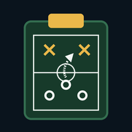

# Prancheta

**Carreira de técnico de futebol, decidida carta a carta.**

Assuma um clube, tome as decisões que aparecem na sua mesa, assista às partidas animadas
e construa uma carreira entre a Europa e a América do Sul.


### [▶ Jogar agora](https://SEU-USUARIO.github.io/prancheta/)

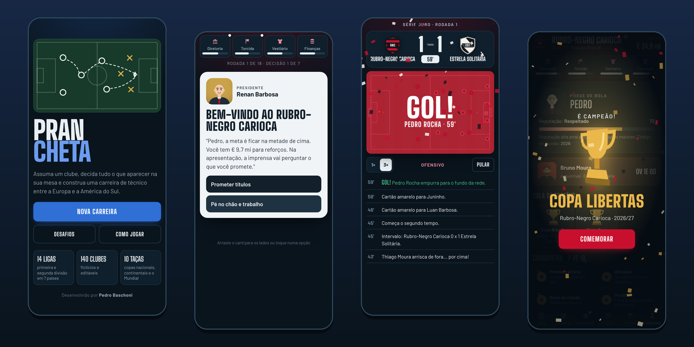

</div>

---

## Sobre o jogo

O Prancheta é um jogo de gerenciamento de futebol no estilo *Reigns*: em vez de planilhas,
você comanda o clube respondendo a situações que chegam toda semana. Escalar o garoto da base
ou o veterano? Vender o craque para salvar as contas? Provocar o rival na coletiva?
Cada escolha mexe em quatro medidores, e se qualquer um zerar, você está demitido.

Nenhuma carreira é igual à outra: o mundo é gerado a cada partida, as cartas dependem do
momento do seu clube e várias decisões viram histórias que voltam semanas depois.

## Funcionalidades

| | |
|---|---|
| 🌍 **14 ligas, 140 clubes** | Primeira e segunda divisão de Espanha, Inglaterra, Itália, Alemanha, França, Brasil e Argentina, com acesso e rebaixamento |
| 🏆 **10 competições** | Ligas, copas nacionais, Liga das Estrelas, Copa Libertas e Mundial de Clubes |
| 🃏 **Mais de 85 tipos de carta** | Vestiário, imprensa, diretoria, torcida, mercado e departamento médico, com histórias em cadeia |
| ⚖️ **Quatro medidores** | Diretoria, Torcida, Vestiário e Finanças. Zerou um, perdeu o emprego |
| ⚽ **Partidas animadas** | Campo 2D, narração lance a lance, decisões no intervalo, pênaltis e reta final |
| 💰 **Mercado completo** | Compra e venda nas janelas, empréstimos, joias da base e apostas do olheiro |
| 😤 **Arquirrival** | Um técnico rival que te persegue de clube em clube, com retrospecto guardado |
| 📈 **Jogadores vivos** | Personalidades, evolução, envelhecimento, aposentadoria e revelações da base |
| ✏️ **Editor de clubes** | Mude nome, sigla, cores e escudo de qualquer time |
| 🎯 **Modos extras** | Hardcore (uma vida só), 4 desafios e código de mundo para desafiar os amigos |
| 🏅 **18 conquistas** | Além da sala de troféus e do hall da fama |
| 📱 **Instalável e offline** | Funciona como app no celular, sem internet |

## Telas

<table>
  <tr>
    <td align="center">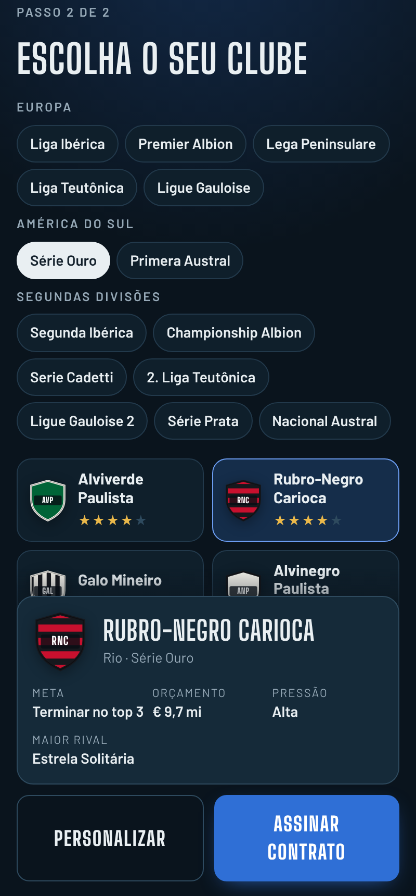<br><sub>Escolha do clube</sub></td>
    <td align="center">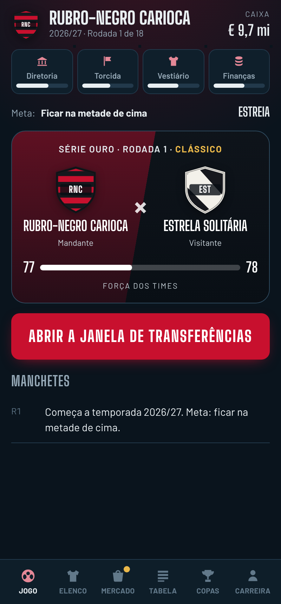<br><sub>Painel da semana</sub></td>
    <td align="center">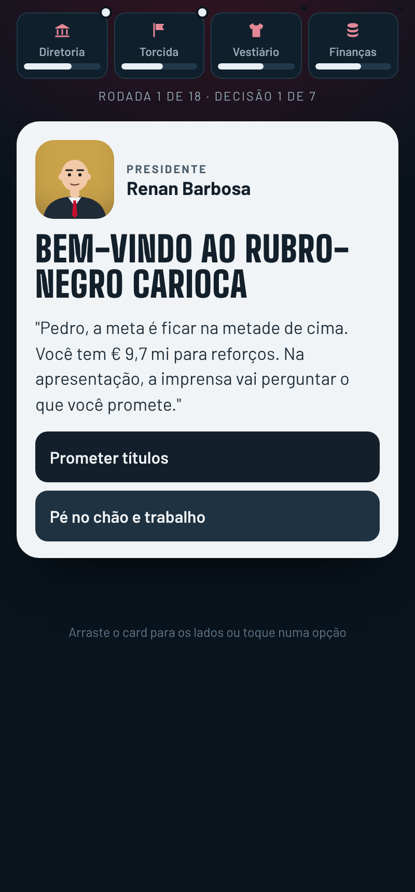<br><sub>Cartas de decisão</sub></td>
  </tr>
  <tr>
    <td align="center">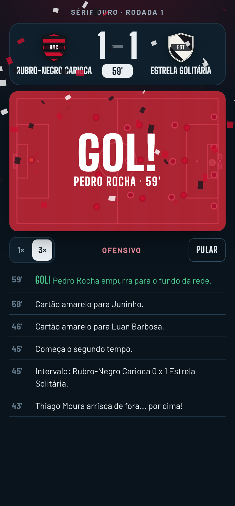<br><sub>Partida ao vivo</sub></td>
    <td align="center">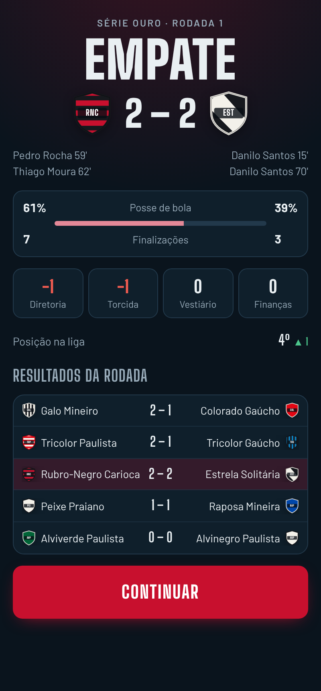<br><sub>Pós-jogo</sub></td>
    <td align="center">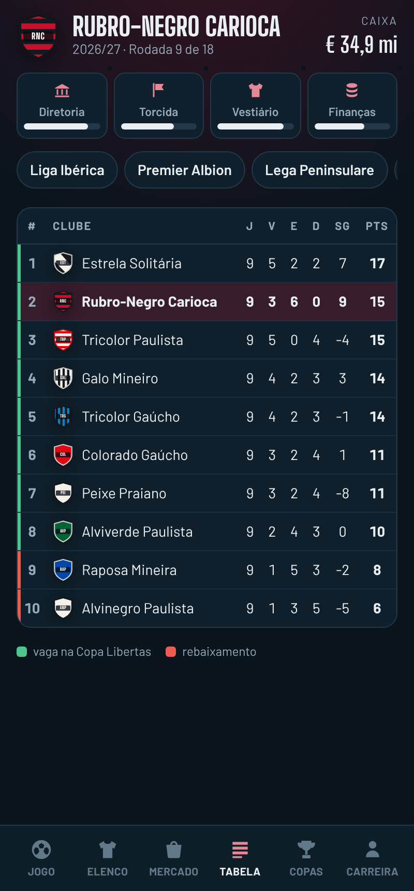<br><sub>Classificação</sub></td>
  </tr>
  <tr>
    <td align="center">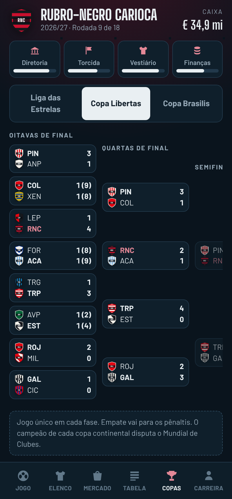<br><sub>Mata-mata continental</sub></td>
    <td align="center">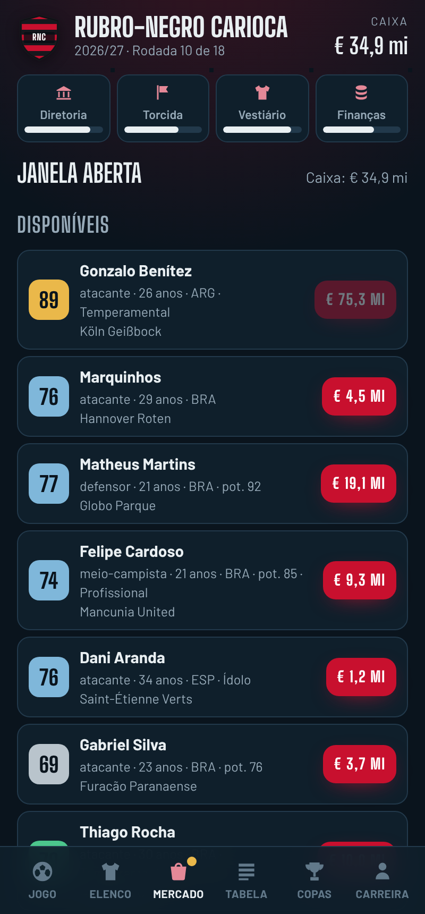<br><sub>Mercado de transferências</sub></td>
    <td align="center">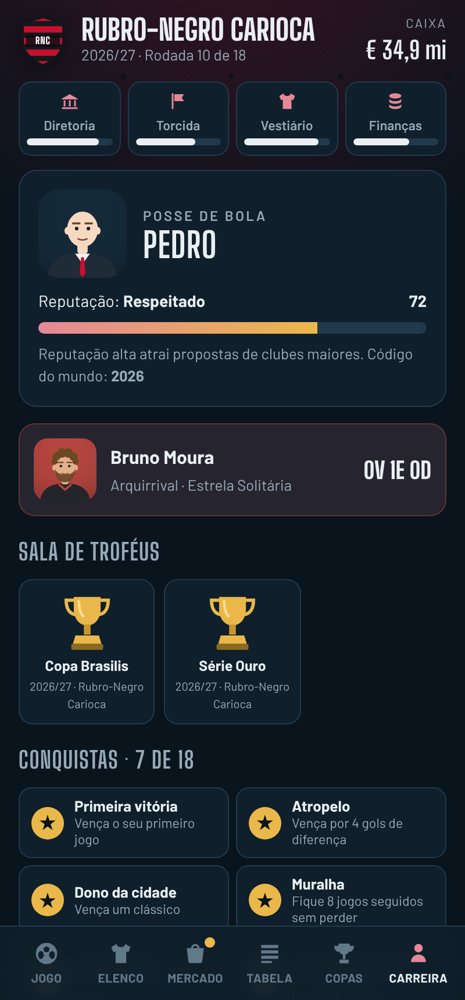<br><sub>Carreira e conquistas</sub></td>
  </tr>
</table>

## Como jogar

1. **Crie o técnico:** nome, visual, filosofia de jogo (posse, contra-ataque ou pressão) e modo.
2. **Escolha o clube:** de gigantes europeus a times da segunda divisão sul-americana.
3. **Decida:** arraste as cartas para os lados ou toque numa opção. Os pontinhos nos medidores mostram o que cada escolha vai afetar.
4. **Jogue:** assista à partida (ou pule) e reaja nos momentos decisivos.
5. **Monte o elenco:** escale os titulares, troque a formação e negocie nas janelas.
6. **Siga a carreira:** no fim da temporada chegam propostas de outros clubes, inclusive do outro continente.

## Tecnologia

- **HTML, CSS e JavaScript puros**, sem frameworks e sem etapa de build: o jogo inteiro está no `index.html`
- **Canvas 2D** para a partida animada e **SVG** gerado em código para escudos, rostos e troféus
- **Web Audio API** para apito, torcida e efeitos, todos sintetizados (nenhum arquivo de áudio)
- **PWA** com `manifest.webmanifest` e *service worker* para instalar e jogar offline
- **localStorage** para salvar a carreira e as edições de clubes
- Gerador de números com semente: o mesmo código de mundo gera o mesmo mundo

## Estrutura

```
prancheta/
├── index.html              # o jogo inteiro
├── manifest.webmanifest    # dados do app instalável
├── sw.js                   # service worker (modo offline)
├── fonts/                  # Barlow e Big Shoulders Display
├── icons/                  # ícones do app
├── docs/                   # imagens deste README
└── LICENSE
```

## Rodar no computador

Basta abrir o `index.html` no navegador. Para testar a instalação como app, sirva a pasta
com um servidor local, por exemplo:

```bash
npx serve .
```

## Versão Android

Existe também uma versão em Flutter que empacota o mesmo jogo como APK, para instalar
direto no celular.

## Aviso

Todos os clubes, ligas, competições e jogadores são fictícios. Qualquer semelhança com
a vida real é homenagem ao futebol.

---

<div align="center">

Desenvolvido por **Pedro Baschoni**

</div>
